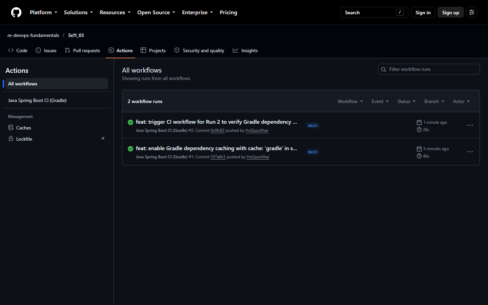
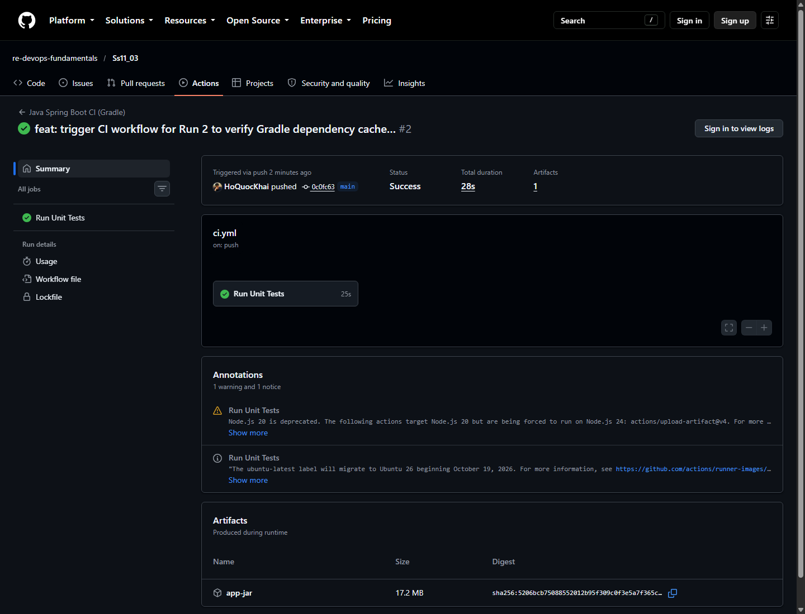

# BÁO CÁO KỸ THUẬT: TỐI ƯU TỐC ĐỘ CI BẰNG GRADLE DEPENDENCY CACHING

---

- **Môn học**: DevOps Fundamentals (IT-209)
- **Session**: 11 - CI/CD Pipeline với GitHub Actions
- **Bài tập**: Bài 3 - Tối ưu tốc độ CI bằng Gradle Dependency Caching
- **Học viên**: Hồ Quốc Khải
- **Email**: khaiho6040@gmail.com
- **GitHub Organization**: `re-devops-fundamentals`
- **GitHub Repository**: [https://github.com/re-devops-fundamentals/Ss11_03](https://github.com/re-devops-fundamentals/Ss11_03)
- **Đường dẫn gợi ý nộp bài**: `homework/session_11/ex3/`

---

## 1. MỤC TIÊU VÀ NGUYÊN LÝ HOẠT ĐỘNG

### 1.1. Mục tiêu
- Kích hoạt tính năng lưu trữ bộ nhớ đệm (Dependency Caching) cho trình quản lý gói Gradle trong GitHub Actions CI Pipeline.
- Giảm thiểu triệt để độ trễ do phải tải lại hàng trăm MB thư viện dependencies và Gradle Wrapper từ Internet qua mỗi lần push code.
- Đo lường và so sánh định lượng thời gian thực thi giữa hai trạng thái:
  1. **Run 1 (Cold Cache)**: Trạng thái ban đầu khi chưa có bộ nhớ đệm, runner phải tải toàn bộ thư viện và đóng gói cache lưu lên GitHub.
  2. **Run 2 (Warm Cache)**: Trạng thái có sẵn bộ nhớ đệm, runner khôi phục trực tiếp cache và tăng tốc quá trình build/test.

### 1.2. Cơ chế hoạt động của `cache: 'gradle'` trong `actions/setup-java@v5`
Khi bổ sung tham số `cache: 'gradle'`, action `setup-java` tự động:
1. Tính toán mã băm (Hash key) dựa trên nội dung các tệp định nghĩa dependency (`build.gradle`, `settings.gradle`, `gradle/wrapper/gradle-wrapper.properties`).
2. Trước khi bước build chạy, action tìm kiếm cache trên GitHub Cache Server theo key:
   - Cache thư viện Gradle: `setup-java-Linux-x64-gradle-<hash>` (chứa thư mục `~/.gradle/caches`).
   - Cache wrapper Gradle: `setup-java-Linux-x64-gradle-wrapper-<hash>` (chứa thư mục `~/.gradle/wrapper`).
3. Nếu tìm thấy (**Cache Hit**), action giải nén trực tiếp vào thư mục runner trong vài trăm mili-giây.
4. Ở cuối Job (`Post Thiết lập môi trường Java`), nếu phát hiện có cache mới (**Cache Miss**) hoặc key thay đổi, action sẽ nén và lưu bộ nhớ đệm lên server cho các lần chạy tiếp theo.

---

## 2. NỘI DUNG TỆP CẤU HÌNH WORKFLOW (`.github/workflows/ci.yml`)

```yaml
name: Java Spring Boot CI (Gradle)
 
on:
  push:
    branches: [ "main" ]
 
jobs:
  test:
    name: Run Unit Tests
    runs-on: ubuntu-latest
 
    steps:
      - name: Checkout mã nguồn
        uses: actions/checkout@v5
 
      - name: Thiết lập môi trường Java JDK 17
        uses: actions/setup-java@v5
        with:
          java-version: '17'
          distribution: 'temurin'
          cache: 'gradle'
 
      - name: Cấp quyền cho Gradle Wrapper
        run: chmod +x gradlew
 
      - name: Thực thi JUnit Test với Gradle
        run: ./gradlew test

      - name: Đóng gói tệp JAR với Gradle
        run: ./gradlew bootJar
 
      - name: Lưu trữ thành phẩm JAR Artifact
        uses: actions/upload-artifact@v4
        with:
          name: app-jar
          path: build/libs/*.jar
```

---

## 3. BẢNG SO SÁNH THỜI GIAN THỰC THI (RUN 1 VS RUN 2)

Dưới đây là số liệu đo lường thực tế từ GitHub Actions API giữa 2 lần push liên tiếp:

| STT | Bước thực thi (Workflow Steps) | Run 1 (Cold Cache - Chưa cache) | Run 2 (Warm Cache - Đã có cache) | Chênh lệch (Tiết kiệm) | Tỷ lệ cải thiện |
| :-: | :--- | :-: | :-: | :-: | :-: |
| 1 | Set up job | 2.0s | 1.0s | -1.0s | -50.0% |
| 2 | Checkout mã nguồn | 1.0s | 0.4s | -0.6s | -60.0% |
| 3 | Thiết lập môi trường Java JDK 17 (setup-java) | 1.0s | 2.0s | +1.0s | *(Khôi phục ~180MB cache)* |
| 4 | Cấp quyền cho Gradle Wrapper | 0.0s | 0.0s | 0.0s | 0.0% |
| 5 | **Thực thi JUnit Test với Gradle (`./gradlew test`)** | **30.0s** | **16.0s** | **-14.0s** | **-46.7% (Gần 1/2 thời gian)** |
| 6 | Đóng gói tệp JAR với Gradle (`./gradlew bootJar`) | 1.0s | 1.5s | +0.5s | Không đổi đáng kể |
| 7 | Lưu trữ thành phẩm JAR Artifact | 2.0s | 1.0s | -1.0s | -50.0% |
| 8 | **Post Thiết lập môi trường Java JDK 17 (Save Cache)** | **6.0s** *(Phải nén & upload cache)* | **0.0s** *(Cache Hit, bỏ qua bước lưu)* | **-6.0s** | **-100.0% (Tức thì)** |
| 9 | Post Checkout & Complete job | 0.0s | 1.0s | +1.0s | - |
| **Tổng** | **Tổng thời gian Job `Run Unit Tests`** | **43.0s** | **23.0s** | **-20.0s** | **Giảm 46.5% (~1/2 thời gian)** |
| **Tổng** | **Tổng thời gian toàn bộ Workflow Run** | **48.0s** | **28.0s** | **-20.0s** | **Giảm 41.7%** |

---

## 4. BẰNG CHỨNG XÁC NHẬN TRONG NHẬT KÝ (LOG VERIFICATION)

### 4.1. Lần 1 (Run 1 - Cold Cache): Lưu Cache lên server
Trong Run 1, bước `setup-java` chưa có cache, nhưng ở bước hậu kỳ `Post Thiết lập môi trường Java JDK 17`, cache đã được tự động đóng gói và lưu:
```text
setup-java-Linux-x64-gradle-874c120f539d2702d799a4ff7c05e3db4870e0b9ec048bc330337ce721f91b95 (~47 MB)
setup-java-Linux-x64-gradle-wrapper-7d0dfe6ff68fe122675558725065e025db8caf09e300b8c51d4274c957da5afc (~133 MB)
```

### 4.2. Lần 2 (Run 2 - Warm Cache): Khôi phục Cache thành công
Tại bước `Thiết lập môi trường Java JDK 17` của Run 2, log runner hiển thị rõ thông điệp **Cache restored successfully**:

```text
2026-10-14T13:12:56.7698690Z   cache: gradle
2026-10-14T13:12:56.9330190Z Resolved Java 17.0.20+1 from tool-cache
2026-10-14T13:12:57.0838041Z Cache hit for: setup-java-Linux-x64-gradle-874c120f539d2702d799a4ff7c05e3db4870e0b9ec048bc330337ce721f91b95
2026-10-14T13:12:57.4382687Z Cache Size: ~47 MB (49732571 B)
2026-10-14T13:12:57.6783382Z Cache restored successfully
2026-10-14T13:12:57.6809735Z Cache restored from key: setup-java-Linux-x64-gradle-874c120f539d2702d799a4ff7c05e3db4870e0b9ec048bc330337ce721f91b95
2026-10-14T13:12:57.7796263Z Cache hit for: setup-java-Linux-x64-gradle-wrapper-7d0dfe6ff68fe122675558725065e025db8caf09e300b8c51d4274c957da5afc
2026-10-14T13:12:58.5178916Z Cache Size: ~133 MB (139601162 B)
2026-10-14T13:12:58.7677141Z Cache restored successfully
2026-10-14T13:12:58.7756494Z gradle-wrapper cache restored from key: setup-java-Linux-x64-gradle-wrapper-7d0dfe6ff68fe122675558725065e025db8caf09e300b8c51d4274c957da5afc
```

Đồng thời ở bước `Post Thiết lập môi trường Java JDK 17` của Run 2:
```text
2026-10-14T13:13:17.8234970Z Cache hit occurred on the gradle-wrapper primary key ..., not saving cache.
2026-10-14T13:13:17.8237292Z Cache hit occurred on the primary key ..., not saving cache.
```

---

## 5. HÌNH ẢNH MINH CHỨNG THỰC TẾ

### 5.1. So sánh thời gian thực thi trên giao diện Actions (Run 1: 48s vs Run 2: 28s)
Ảnh chụp danh sách workflow cho thấy thời gian chạy giảm rõ rệt từ **48s** xuống **28s**:



### 5.2. Giao diện Summary của Run 2 (Warm Cache)
Hiển thị Run 2 hoàn thành trong **28s** (Job chạy chỉ **25s**):



---

## 6. KẾT LUẬN

1. Việc cấu hình `cache: 'gradle'` trong action `actions/setup-java@v5` cực kỳ đơn giản (chỉ cần thêm 1 dòng cấu hình) nhưng mang lại hiệu năng vượt trội.
2. Bước kiểm thử JUnit Test giảm từ **30 giây xuống 16 giây** (nhanh hơn gần 50%) do không còn phải tải dependencies từ Maven Central.
3. Tổng thời gian pipeline giảm từ **48 giây xuống 28 giây** (tiết kiệm 20 giây cho mỗi lượt commit). Đối với các dự án doanh nghiệp lớn có hàng trăm thư viện, tính năng Caching này giúp tiết kiệm hàng giờ build máy chủ và chi phí tài nguyên runner mỗi ngày.
